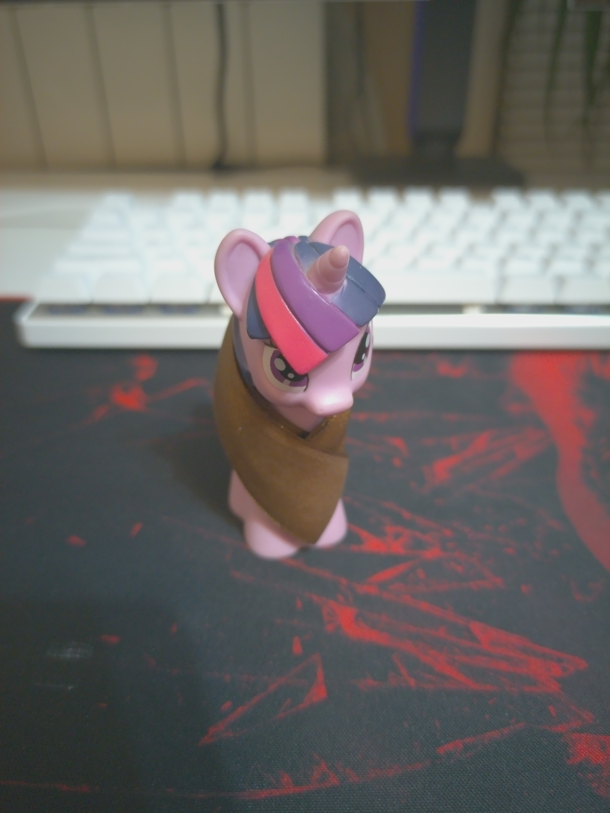
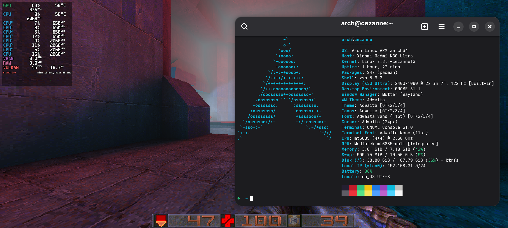
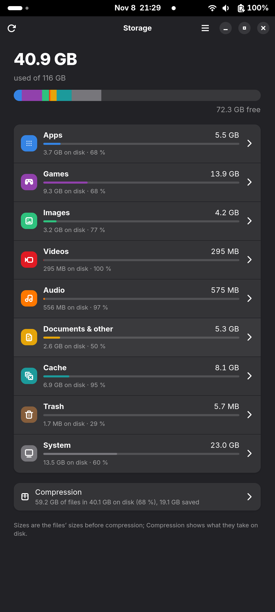

# About:

### What this?

Vibecoded port of mainline linux to Redmi K30 Ultra. That's it.

### Current status?

Most of it works. All drivers at least ported and confirmed working. There are few missing non-priority features, like wired headset's buttons support. And some things are implemented, but not tested: bi-directional calls for example - I have no one to call, so yeah. 

 
  
Images

1. Example photo from main camera via camera app. No HDR, 64MP or portrait was used (those are processed via APU and heavily alter the look of final image):
  
  

2. Screenshot from running vkQuake with [Brutalist Jam 3](https://www.slipseer.com/index.php?resources/quake-brutalist-jam-iii.549/). Have in mind that running windowed roughly halfs performance, probably due to mutter compositing.
   
  

Other than that, it's drop-in replacement for stock ROM. Sort of.

### My device have same {driver_name}, what do I need to port it?

You can check info on each driver and it's progress in [hardware.md](hardware.md) 

Pay close attention to used firmware - some of it wasn't reverse engineered and driver may still expect original data from MIUI to exist in it's dedicated partition.  

### Can we address the elephant in the room? 

There are couple caveats:
1. Project fully vibesloped. It was intended to be local only thing, but some people asked me to release the files, hence I'm releasing it;
2. No support whatsoever, if you decided to use anything within this repo;
3. Nothing from this repo will be pushed to mainline as is. If you need something, you will need to review it before push and then maintain on your own.

### Other known quirks?

Yep, a few:
1. Those who will bother to check this repo, will notice, that custom PKGBUILDs have even gnome-shell and mutter. The reason behind it is that gnome's UX/UI absolutely awful on the phone:
   - Mutter pre-rotates image if your screen is rotated (or even if not rotated, just for fun I guess), doing so cost enormous amount of GPU performance, which this particular iGPU have none to spare. It can cost ~30-40% in vkQuake simply due to mutter compositing. Patch helps with hardware pre-rotating, which fixes that.
   - Other known gnome quirk - it's laggy on the first launch. Which is not a big deal on PC or notebook where you mostly don't even see that due share performance gap, but going to the the fact that we running weak phone here, plus lockscreen state basically counts as restart - it's basically unusable. The reason behind lag is that gnome recalculates objects in menus each restart. Why? Who da hell knows, ask gnome devs. Meanwhile fixed via patch.
   - There also a lot of gnome extensions that work in tandem with patches to make gnome usable. For example there are no support for AOD or unlock via fingerprint sensor (technically support is there, but not for our case where fingerprint sensor inside the screen, which also requires highlighting the area on command).
2. There are no support of most phone-like features in desktop linux, hence need for custom apps that have been built. It includes gnome maps with GPS support, FM-radio, compass+magnetometer app and camera app. Technically there is camera app in stock gnome, but it doesn't support anything beyond simply making photos. On top of that list there also neat used-storage app that shows what exactly uses partition.

Similarly to how android does it.
 

  

     

 

